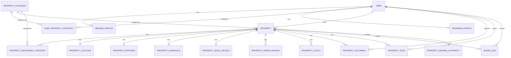

# Database schema proposal

**Status:** Implemented for solo-broker v1  
**Scope:** PostgreSQL schema for the first property-listing release  
**Related contract:** [Frontend API contract](../api/frontend-api-contract.md)

This document describes the solo-broker v1 design implemented in `app/models`. The initial migration is `migrations/versions/0001_initial_schema.py`. If model fields or endpoint payloads change, update this document and the API contract together.

## 1. Design goals

- Use Cognito as the identity provider; store the stable Cognito `sub` as the external identity key.
- Keep property and document data scoped to the authenticated broker account so another broker cannot read it accidentally.
- Save each property wizard section independently, while keeping relational data queryable for lists and filters.
- Keep object bytes in S3-compatible storage. PostgreSQL stores object metadata and ownership, never the file body.
- Treat broker-only notes, exact coordinates, legal documents, and public listing data as different privacy levels.
- Prefer UUID primary keys, UTC timestamps, explicit foreign keys, database constraints, and Alembic migrations.

## 2. Proposed entity relationship

For v1, each Cognito user is one broker account and owns their own properties. There are no brokerage, organization, membership, invite, assigned-associate, or teammate-login tables in this schema. Team access is a future product phase and will need an explicit migration and authorization design.

## 3. Tables and fields

### `users`

Application identity mapped to Cognito. The Cognito user pool remains authoritative for password and login lifecycle.

| Column | Type | Rules / purpose |
|---|---|---|
| `id` | UUID | Primary key |
| `cognito_sub` | VARCHAR(128) | Required, unique; stable Cognito subject |
| `account_email` | CITEXT or VARCHAR(320) | Required; normalized for lookup, not an identity key |
| `is_active` | BOOLEAN | Required, default true; local application access flag |
| `created_at`, `updated_at` | TIMESTAMPTZ | Required, UTC |

Do not store password hashes or Cognito tokens here.

### `broker_profiles`

Professional profile attached one-to-one to a user. Keep the account email in `users` and public business inquiries in `business_profiles`.

| Column | Type | Rules / purpose |
|---|---|---|
| `user_id` | UUID | PK and FK to `users` |
| `legal_name` | VARCHAR(200) | Required after onboarding |
| `mobile_phone` | VARCHAR(40) | Optional private registration contact |
| `operating_language` | VARCHAR(12) | Optional BCP-47 code, e.g. `en`, `ta-IN` |
| `designation` | VARCHAR(200) | Optional |
| `license_number` | VARCHAR(100) | Optional; jurisdiction-specific, not globally unique |
| `license_jurisdiction` | VARCHAR(100) | Optional |
| `created_at`, `updated_at` | TIMESTAMPTZ | Required |

### `business_profiles`

One-to-one business profile owned by the same broker account, kept separate from the broker's professional/license details because the HTML has distinct Business Profile and Broker Profile screens.

| Column | Type | Rules / purpose |
|---|---|---|
| `user_id` | UUID | PK and FK to `users` |
| `business_name` | VARCHAR(200) | Optional business or trading name |
| `public_phone` | VARCHAR(40) | Optional public inquiry number |
| `public_email` | VARCHAR(320) | Optional public inquiry address |
| `city`, `district`, `state` | VARCHAR | Optional operating territory |
| `created_at`, `updated_at` | TIMESTAMPTZ | Required |

### `user_preferences`

One-to-one user settings, not authentication security controls.

| Column | Type | Rules / purpose |
|---|---|---|
| `user_id` | UUID | PK and FK to `users` |
| `theme` | VARCHAR(10) | `light` or `dark`; default `light` |
| `language` | VARCHAR(12) | Default `en` |
| `default_disclosures` | JSONB | Default share-link disclosure choices |
| `default_expiration_days` | INTEGER NULL | Default lifetime for links created from Settings; `NULL` means no expiration; allowed values are 1, 7, 30, 90, or 365 days |
| `created_at`, `updated_at` | TIMESTAMPTZ | Required |

Do not put device PINs or biometric data in this table. Those belong on the client device / secure OS facilities unless a separate server-side security requirement is agreed.

### `onboarding_progress`

Optional one-to-one progress record; onboarding is not needed to read existing property data.

| Column | Type | Rules / purpose |
|---|---|---|
| `user_id` | UUID | PK and FK to `users` |
| `current_step` | VARCHAR(80) | Nullable key for current screen |
| `completed_steps` | JSONB array | Defaults to `[]` |
| `completed_at` | TIMESTAMPTZ | Nullable |
| `updated_at` | TIMESTAMPTZ | Required |

### `properties`

Stable property identity and fields used in listing/search. Wizard-specific details live in section tables below.

| Column | Type | Rules / purpose |
|---|---|---|
| `id` | UUID | Primary key |
| `owner_user_id` | UUID | Required FK to `users`; sole owner in v1 |
| `title` | VARCHAR(200) | Required for draft creation |
| `description` | TEXT | Optional |
| `primary_category_id` | UUID | Required FK to `property_categories`; new selections must be enabled for this user |
| `status` | VARCHAR / enum | `draft`, `active`, `archived`; default `draft` |
| `published_at` | TIMESTAMPTZ | Nullable |
| `created_at`, `updated_at` | TIMESTAMPTZ | Required |
| `archived_at` | TIMESTAMPTZ | Nullable; set when archived |

Use archive state rather than hard deletion for published assets. Permit deletion of drafts only if they have no share links or retained compliance documents; otherwise archive or soft-delete according to retention policy.

### `property_categories`

Shared category catalog. Use rows rather than a database enum so the product can add category definitions without a schema migration.

| Column | Type | Rules / purpose |
|---|---|---|
| `id` | UUID | Primary key |
| `code` | VARCHAR(50) | Required, unique stable API code; initial codes: `agriculture`, `plots`, `house_villa`, `commercial`, `apartment` |
| `label` | VARCHAR(100) | Required display label |
| `sort_order` | INTEGER | Required, default 0 |
| `created_at`, `updated_at` | TIMESTAMPTZ | Required |

The initial Alembic migration inserts the five initial category rows. Do not delete rows referenced by properties.

### `user_property_categories`

Per-broker category setup, matching the Property Setup screen's enabled category choices.

| Column | Type | Rules / purpose |
|---|---|---|
| `user_id` | UUID | FK to `users` |
| `category_id` | UUID | FK to `property_categories` |
| `enabled` | BOOLEAN | Required, default true |
| `sort_order` | INTEGER | Required, defaults from catalog |
| `updated_at` | TIMESTAMPTZ | Required |

Primary key and unique constraint on `(user_id, category_id)`. If an account has no override row, treat the category as enabled with its catalog order. Disabled categories remain readable on existing properties but cannot be selected for newly created or recategorized properties.

### `property_secondary_categories`

Optional additional suitability categories shown as “Secondary Versatility.”

| Column | Type | Rules / purpose |
|---|---|---|
| `id` | UUID | Primary key |
| `property_id` | UUID | FK to `properties` |
| `category_id` | UUID | FK to `property_categories` |
| `created_at` | TIMESTAMPTZ | Required |

Primary key and unique constraint on `(property_id, category_id)`.

### `property_locations`

One-to-one location and cadastral details. Exact coordinates are private by default.

| Column | Type | Rules / purpose |
|---|---|---|
| `property_id` | UUID | PK and FK to `properties` |
| `address_line` | VARCHAR(500) | Optional |
| `pincode` | VARCHAR(20) | Optional; string to preserve leading zeroes and non-numeric formats |
| `village`, `taluk`, `district`, `state` | VARCHAR | Optional address hierarchy |
| `country_code` | CHAR(2) | Optional ISO 3166-1 alpha-2; default can be agreed |
| `latitude`, `longitude` | NUMERIC(9,6), NUMERIC(9,6) | Nullable; paired and range checked |
| `survey_numbers` | JSONB array or child table | Optional; child table preferred if searchable individually |
| `width_ft`, `length_ft`, `road_width_ft` | NUMERIC(12,2) | Optional, non-negative |
| `frontage_direction` | VARCHAR(20) | Optional controlled value |
| `road_access_type` | VARCHAR(80) | Optional controlled value |
| `road_subdivision_basis` | VARCHAR(200) | Optional |
| `highway_distance_km` | NUMERIC(10,2) | Optional, non-negative |
| `updated_at` | TIMESTAMPTZ | Required |

If survey numbers need reliable search, uniqueness, or multiple jurisdiction fields, use `property_survey_parcels(property_id, survey_number)` rather than JSONB.

### `property_features`

One-to-one fields that describe agronomy and general site condition.

| Column | Type | Rules / purpose |
|---|---|---|
| `property_id` | UUID | PK and FK to `properties` |
| `soil_type` | VARCHAR / enum | Nullable; controlled type plus `other` |
| `soil_type_other` | VARCHAR(120) | Nullable free-text when type is `other` |
| `water_tds_ppm` | INTEGER | Nullable, non-negative |
| `agronomist_notes` | TEXT | Optional |
| `created_at`, `updated_at` | TIMESTAMPTZ | Required |

### `property_water_sources`

Zero or more sources per property, because the UI can select several (river/canal, borewell, open well, government sluice).

| Column | Type | Rules / purpose |
|---|---|---|
| `id` | UUID | Primary key |
| `property_id` | UUID | Required FK to `properties` |
| `source_type` | VARCHAR / enum | `river`, `canal`, `borewell`, `open_well`, `government_supply`, `other` |
| `label` | VARCHAR(160) | Optional user-facing label |
| `depth_ft` | NUMERIC(10,2) | Optional; borewell/open well detail |
| `diameter_ft` | NUMERIC(10,2) | Optional; open well detail |
| `yield_inches` | NUMERIC(8,2) | Optional; validate domain unit/meaning before freezing |
| `seasonality` | VARCHAR(200) | Optional |
| `details` | TEXT | Optional |
| `created_at`, `updated_at` | TIMESTAMPTZ | Required |

### `property_utilities`

Zero or more utility/access features, permitting multiple values without a new column for every selectable feature.

| Column | Type | Rules / purpose |
|---|---|---|
| `id` | UUID | Primary key |
| `property_id` | UUID | Required FK to `properties` |
| `utility_type` | VARCHAR / enum | Initial options: `electricity`, `irrigation`, `fencing`, `road_access`, `other` |
| `available` | BOOLEAN | Required |
| `details` | TEXT | Optional, e.g. voltage, irrigation schedule |
| `created_at`, `updated_at` | TIMESTAMPTZ | Required |

### `property_financials`

One-to-one financial terms. Store currency explicitly; initial product currency is INR.

| Column | Type | Rules / purpose |
|---|---|---|
| `property_id` | UUID | PK and FK to `properties` |
| `currency` | CHAR(3) | Required ISO 4217; default `INR` |
| `asking_price_inr` | BIGINT | Nullable, non-negative; whole INR rupees |
| `minimum_price_inr` | BIGINT | Nullable, non-negative and no greater than asking price |
| `negotiable` | BOOLEAN | Nullable until specified |
| `area` | NUMERIC(18,4) | Nullable, greater than zero |
| `area_unit` | VARCHAR(30) | Required when area is set; controlled code such as `acre`, `cent`, `sqft`, `hectare` |
| `advance_amount_inr` | BIGINT | Nullable, non-negative |
| `payment_milestones_flexible` | BOOLEAN | Nullable |
| `lending_bank` | VARCHAR(200) | Nullable |
| `outstanding_loan_inr` | BIGINT | Nullable, non-negative |
| `updated_at` | TIMESTAMPTZ | Required |

For the proposed India-focused MVP, amounts are whole INR rupees. If paise precision or additional currencies are required, change the storage and API contract together before implementation.

### `property_legal_details`

One-to-one legal classification and optional legal notes. Do not put file bytes or raw signing credentials here.

| Column | Type | Rules / purpose |
|---|---|---|
| `property_id` | UUID | PK and FK to `properties` |
| `title_classification` | VARCHAR / check constraint | Optional: `ryotwari_patta`, `natham`, `gramathu_natham`, or `other` |
| `legal_summary` | TEXT | Optional, non-confidential summary only |
| `updated_at` | TIMESTAMPTZ | Required |

The HTML lists “Signing Authorities” and “Verified Legal Documents.” Signing authority data may contain personal/legal details and should be modeled separately after its meaning and access rules are confirmed.

### `property_documents`

File metadata for both property documents and property media. File contents remain in the object store.

| Column | Type | Rules / purpose |
|---|---|---|
| `id` | UUID | Primary key |
| `property_id` | UUID | Required FK to `properties` |
| `uploaded_by_user_id` | UUID | Required FK to `users` |
| `object_key` | VARCHAR(1024) | Required, unique; generated by backend |
| `original_filename` | VARCHAR(255) | Required, sanitized for display |
| `display_name` | VARCHAR(255) | Optional |
| `content_type` | VARCHAR(150) | Required; validated allowlist |
| `size_bytes` | BIGINT | Nullable until verified after upload; positive |
| `checksum_sha256` | VARCHAR(64) | Nullable lowercase hexadecimal SHA-256 digest after object verification |
| `category` | VARCHAR / enum | `photo`, `title_deed`, `survey`, `soil_report`, `voice_memo`, `other`; voice memos are private-only |
| `visibility` | VARCHAR / enum | `private`, `shared`, `public`; default `private` |
| `upload_status` | VARCHAR / enum | `pending`, `uploaded`, `rejected`, `deleted` |
| `created_at`, `updated_at` | TIMESTAMPTZ | Required |
| `deleted_at` | TIMESTAMPTZ | Nullable for auditable removal |

Property-scoped registration verifies object existence, positive size within `S3_MAX_UPLOAD_BYTES` (default 25 MiB), exact stored content type, and a ranged PDF/image/audio signature before marking a row `uploaded`. Voice memos use the existing document table and object store, remain private, and are omitted from public sharing. Legal document verification means storage integrity only; it is not a legal-validity or signer-identity decision. Metadata is created only after successful upload verification.

### `property_notes`

Private broker/internal notes, separated from public descriptions.

| Column | Type | Rules / purpose |
|---|---|---|
| `property_id` | UUID | PK and FK to `properties`; one notes row per property |
| `body` | TEXT | Required |
| `created_at`, `updated_at` | TIMESTAMPTZ | Required |

V1 stores one editable private notes field per property, matching the single field in the UI. The row is authorized through its property owner.

### `share_links`

Public access grants with per-link disclosure controls. Never store a plaintext bearer token. Store a cryptographic hash for public lookup and an authenticated-encryption ciphertext so the owner can recover the URL later. Existing links created before encrypted-token recovery remain unrecoverable and keep a null ciphertext.

| Column | Type | Rules / purpose |
|---|---|---|
| `id` | UUID | Primary key |
| `property_id` | UUID | Required FK to `properties` |
| `created_by_user_id` | UUID | Required FK to `users` |
| `token_hash` | BYTEA / CHAR(64) | Required, unique, hash of random token |
| `token_ciphertext` | BYTEA | Nullable for legacy links; authenticated encryption of token for owner-only URL recovery |
| `title` | VARCHAR(200) | Optional label such as “VIP Investor Deck” |
| `visibility` | VARCHAR(16) | Required: `private`, `protected`, or `unlisted`; existing links migrate as `unlisted` |
| `passcode_hash` | VARCHAR(256) | Nullable salted scrypt hash; required when visibility is `protected` |
| `disclosures` | JSONB | Required allowlist booleans for price, coordinates, photos, reports, access roads |
| `expires_at` | TIMESTAMPTZ | Nullable only if non-expiring links are approved |
| `revoked_at` | TIMESTAMPTZ | Nullable |
| `created_at`, `updated_at` | TIMESTAMPTZ | Required |

Public resolution requires a matching non-expired, non-revoked link and an active property. Public responses must explicitly select allowed fields. Never expose `property_notes`, legal/private documents, owner identifiers, exact coordinates unless the link explicitly grants that disclosure, or internal broker contact data.

### `profile_share_links`

One share link can expose basic public business profile details, all active properties, or both. The link belongs to a single broker; it does not grant app access.

| Column | Type | Rules / purpose |
|---|---|---|
| `id` | UUID | Primary key |
| `owner_user_id` | UUID | Required FK to `users`; cascades on account removal |
| `token_hash` | BYTEA / CHAR(64) | Required, unique SHA-256 hash of an unguessable random token |
| `token_ciphertext` | BYTEA | Authenticated encryption for owner-only URL recovery |
| `title` | VARCHAR(200) | Required share-link label |
| `include_profile`, `include_properties` | BOOLEAN | At least one must be true; switches control each public section |
| `property_disclosures` | JSONB | Required map of property UUID strings to full share disclosure objects; overrides apply only to active owned properties, and omitted properties use owner defaults |
| `visibility` | VARCHAR(16) | `unlisted` or `protected` |
| `passcode_hash` | VARCHAR(256) | Nullable salted scrypt hash; required when protected |
| `expires_at`, `revoked_at` | TIMESTAMPTZ | Optional expiration and revocation time |
| `created_at`, `updated_at` | TIMESTAMPTZ | Required |

The public profile allowlist is business name, professional title, public inquiry phone/email, and business territory. The portfolio allowlist is active property title, description, category, price, area with explicit unit, and district/state approximate location. Its full listing view uses that property's configured `property_disclosures` override, falling back to the owner's defaults when no override exists. Exclude private mobile, legal/license data, drafts, archived properties, exact coordinates unless explicitly disclosed, and private notes.

### `property_signing_authorities`

External people recorded by the broker as signing authorities for one property. These rows do not grant app access and do not establish legal verification.

| Column | Type | Rules / purpose |
|---|---|---|
| `id` | UUID | Primary key |
| `property_id` | UUID | Required FK to `properties`; cascades on property deletion |
| `name` | VARCHAR(200) | Required |
| `phone` | VARCHAR(40) | Optional contact number |
| `relationship` | VARCHAR(120) | Required relation to the property/owner |
| `record_label` | VARCHAR(120) | Optional supporting record name |
| `record_value` | VARCHAR(255) | Optional reference or record number |
| `verification_status` | VARCHAR(20) | Server-controlled `pending`; no verification workflow is implemented |
| `signature_status` | VARCHAR(20) | Server-controlled `pending`; no signature workflow is implemented |
| `created_at`, `updated_at` | TIMESTAMPTZ | Required |

The API replaces the full list and allows at most six records per property. It returns pending statuses until a real verification/signature process exists.

## 4. Indexes and database constraints

Recommended initial indexes/constraints:

- Unique index on `users.cognito_sub`.
- Index on `users.is_active` for local account access checks.
- Unique index on `property_categories.code`; index user category settings by `(user_id, enabled)`.
- Index on `properties(owner_user_id, status, updated_at DESC)` for the property list.
- Index on `properties(owner_user_id, primary_category_id, status)` for category filters.
- Index on `property_locations(district, state)` if those fields are used for filters.
- Index on `property_financials(asking_price_inr)` and area/unit if range filters are used; confirm query plan after realistic data exists.
- Unique index on `property_documents.object_key`; indexes on `(property_id, category)` and `(property_id, upload_status)`.
- Index water sources and utilities by `property_id`.
- Unique index on `share_links.token_hash`; index on `(property_id, revoked_at, expires_at)`.
- Unique index on `profile_share_links.token_hash`; index on `(owner_user_id, revoked_at, expires_at)`.
- Check `latitude BETWEEN -90 AND 90`, `longitude BETWEEN -180 AND 180`; require both coordinates together or neither.
- Check all price, loan, advance, water TDS, dimensions, and area values are non-negative; area must be positive when present.
- Check `minimum_price_inr <= asking_price_inr` when both values are present.
- Check `area IS NULL` iff `area_unit IS NULL` (or define an intentional exception).
- Every private property query must filter by `owner_user_id` from the authenticated Cognito identity. Child resources must be authorized through their parent property; never trust an owner ID sent by the client.

Use Alembic migrations. Do not create production tables with SQLAlchemy `create_all()` during app startup.

## 5. Deletion and retention proposal

- Draft property: allow hard deletion only before publication and only when there are no audit/retention requirements.
- Active property: archive; do not hard-delete by default.
- Document: soft-delete its metadata first, remove the object according to retention policy, and preserve audit events if required by law or business policy.
- User: deactivate application access without deleting property or audit records.
- Share link: revoke by setting `revoked_at`; do not reuse tokens.

The legal retention period and whether delete should remove S3 content immediately require product/legal confirmation.

## 6. Decisions for future iterations

The v1 implementation uses these decisions. Confirm or revise them before the associated behavior is expanded:

1. **Account ownership (confirmed):** v1 uses one Cognito user per broker account; each property has one `owner_user_id`. No other broker or teammate can log in to that account's data.
2. **Profile cardinality (implemented):** one professional broker profile and one business profile per user, matching the separate screens in the HTML.
3. **Property notes (implemented):** one editable private notes record per property, matching the single notes field in the UI. A multi-entry notes ledger can be added later if required.
4. **Area units and currency:** Confirm supported land units and whole-INR-rupee storage versus paise precision.
5. **Coordinates and cadastral data:** Confirm exact coordinates are private by default; decide whether survey numbers need individual searchable rows.
6. **Upload lifecycle:** Approve pending document row + presign + finalize/HEAD verification, and set max file size/content type/category rules.
7. **Deletion/retention:** Approve draft deletion, active archival, document removal, and retention behavior.
8. **Legal/signing data:** Confirm whether signing authorities and title details are in the first schema or deferred.

Models and the initial Alembic migration implement the v1 choices above. Remaining product decisions may require coordinated model and API changes. Team access remains deferred; future collaboration should introduce brokerage and membership entities rather than sharing one broker's Cognito login.
